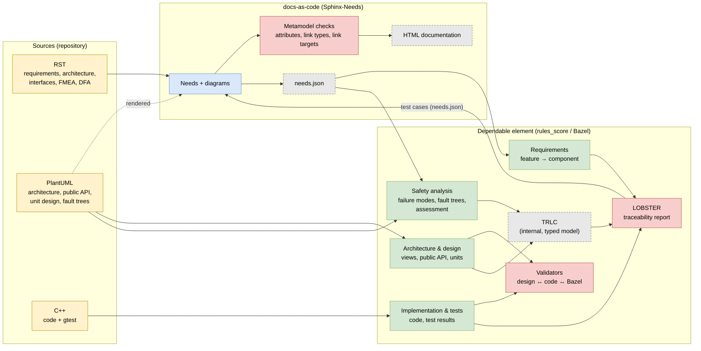
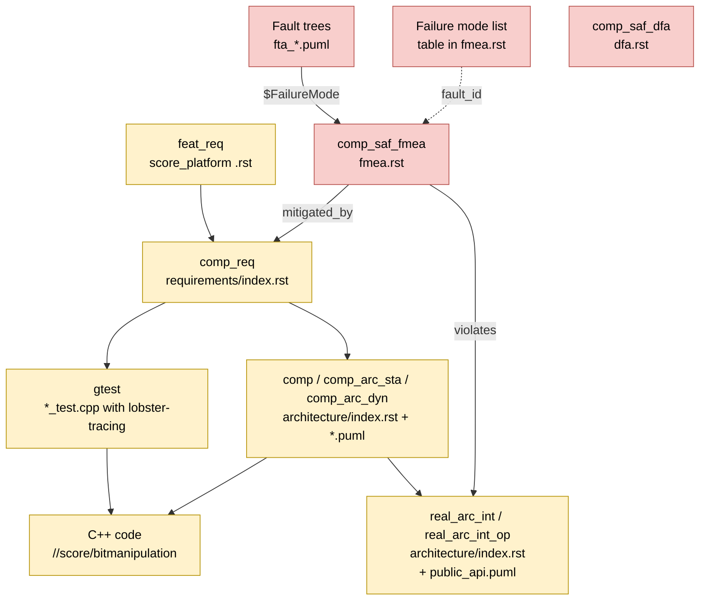

# Dependable element prototype: baselibs / bitmanipulation

Proof of concept for using the rules_score `dependable_element` of
[score_tooling](https://github.com/eclipse-score/tooling) with requirements, architecture
and the FMEA written as Sphinx-Needs in score_docs_as_code. Authors only maintain **RST**,
**PlantUML** and **C++**. Two checking instances work on these sources:

* **docs-as-code** (`//:docs`) checks every single need against the S-CORE metamodel and
  renders the documentation.
* **The dependable element** (`//dependable_element/...`, rules_score) checks that the
  traceability chain is complete and matches code, Bazel targets and test results.

## Overview

Yellow: maintained sources. Blue: docs-as-code. Green: dependable element. Grey dashed:
generated in the build only. Red: checking instances.

## Chain overview

## Safety analysis (FMEA / FTA)

| Check | docs-as-code | Dependable element | Overlap |
|---|---|---|---|
| Mandatory fields present (`fault_id`, `failure_effect`, `sufficient`, `status`, content) | ✔ format (regex) | partly (`failure_effect` must be set) | yes |
| `fault_id` is a known fault model code (MF_01_01 …) | – (only "not empty") | ✔ else build error | – |
| `violates` points to an allowed type (`comp_arc_sta`/`dyn`, `real_arc_int_op`) | ✔ | – | – |
| Target of `violates` / `mitigated_by` exists | ✔ | partly (only `real_arc_int_op` and measures of the DE) | yes |
| `real_arc_int_op` matches exactly one method of `public_api.puml` | – | ✔ else build error | – |
| Every public API method has at least one failure mode | – | ✔ `bitmanipulation_dependability_analysis` | – |
| Types of failure modes, ASIL and guide words are valid | – | ✔ `bitmanipulation_failure_modes_test` (`trlc --verify`) | – |
| Fault tree references an existing failure mode | – | ✔ else build error | – |
| Every failure mode has root causes | – | ✔ dependability analysis | – |
| Every root cause is assessed (FMEA `sufficient: yes`) | – (`sufficient` only yes/no) | ✔ as warning (development) | meaning of `sufficient` |
| Version filter of the measure (`comp_req…[version==1]`) matches | – | ✔ for component requirements | – |
| Measure is of type `comp_req` / `aou_req` | ✔ | – | – |
| Platform AoUs as measure | ✔ link exists | – (not traced) | – |
| Copy of the FTA macros equals the original | – | ✔ `fta_metamodel_copy_test` | – |
| Render FMEA and fault trees | ✔ `fmea.rst` with `.. uml::` | – (`docs = False`) | – |
| DFA | ✔ | – (placeholder only) | – |

## Requirements, architecture and tests

| Check | docs-as-code | Dependable element | Overlap |
|---|---|---|---|
| Link type and target (`satisfies`, `derived_from`, `belongs_to`, `implements`, `included_by`) | ✔ | – | – |
| ID scheme, mandatory attributes, ASIL inheritance (graph checks) | ✔ | – | – |
| Coverage feature req. → component req. → tests | display only (dashboards) | ✔ LOBSTER (warning) | display vs. check |
| Tests run and reference existing requirements | ✔ links of the imported test cases | ✔ gtest results, `lobster-tracing` | yes |
| Static / dynamic architecture against Bazel targets and public API | – | ✔ architecture validators | – |
| Unit design (class diagram) against C++ code | – | ✔ libclang | – |
