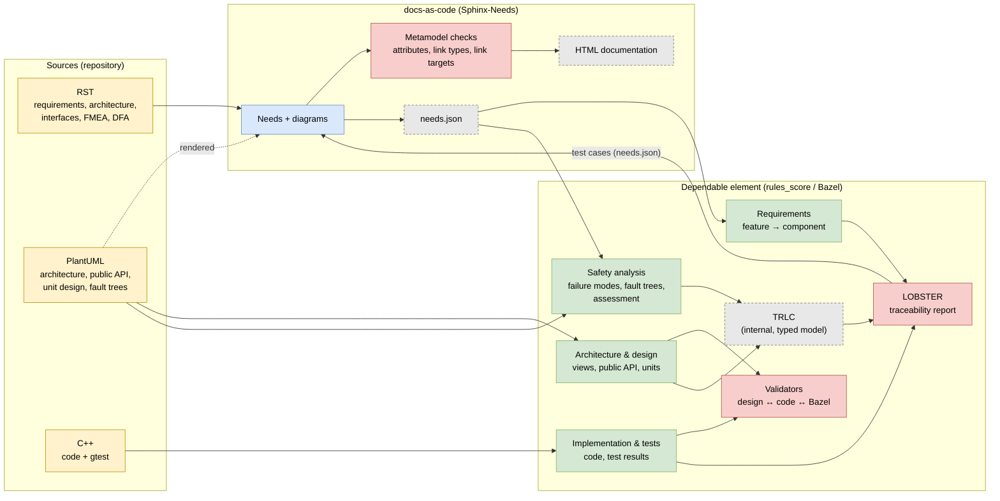
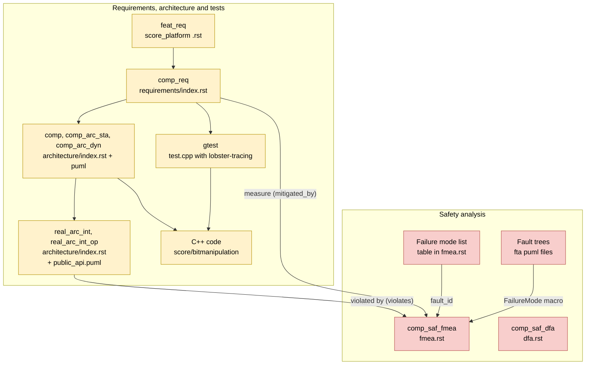

# Dependable element prototype: baselibs / bitmanipulation

Related pull requests (all drafts, to be reviewed together):

| Repository | Pull request | Content |
|---|---|---|
| baselibs | [#799](https://github.com/eclipse-score/baselibs/pull/799) | this prototype: dependable element, interfaces, FMEA, fault trees (do not merge) |
| score_tooling | [#575](https://github.com/eclipse-score/tooling/pull/575) | rules_score: requirements and FMEA from Sphinx-Needs, test cases back as needs |
| score_docs_as_code | [#1039](https://github.com/eclipse-score/docs-as-code/pull/1039) | import of the test cases; `comp_saf_fmea` may violate `real_arc_int_op` |

Proof of concept for using the rules_score `dependable_element` of
[score_tooling](https://github.com/eclipse-score/tooling) with requirements, architecture
and the FMEA written as Sphinx-Needs in score_docs_as_code. Authors only maintain **RST**,
**PlantUML** and **C++**. Two checking instances work on these sources:

* **docs-as-code** (`//:docs`) checks every single need against the S-CORE metamodel and
  renders the documentation.
* **The dependable element** (`//dependable_element/...`, rules_score) checks that the
  traceability chain is complete and matches code, Bazel targets and test results.

## Checks overview

Yellow: maintained sources. Blue: docs-as-code. Green: dependable element. Grey dashed:
generated in the build only. Red: checking instances.

## Metamodel overview

## Safety analysis (FMEA / FTA)

| Check | docs-as-code | Dependable element | Overlap |
|---|---|---|---|
| Mandatory fields present (`fault_id`, `failure_effect`, `sufficient`, `status`, content) | ✔ format (regex) | partly (`failure_effect` must be set) | yes |
| `fault_id` is a known fault model code (MF_01_01 …) | – (only "not empty") | ✔ else build error | – |
| `violates` points to an allowed type (`comp_arc_sta`/`dyn`, `real_arc_int_op`) | ✔ | – | – |
| Target of `violates` / `mitigated_by` exists | ✔ | partly (only `real_arc_int_op` and measures of the DE) | yes |
| `real_arc_int_op` matches exactly one method of `public_api.puml` | – | ✔ else build error | – |
| Every public API method has at least one failure mode | – | ✔ `bitmanipulation_dependability_analysis` | – |
| Types of failure modes, ASIL and guide words are valid | – | ✔ `bitmanipulation_failure_modes_test` (`trlc --verify`) | – |
| Fault tree references an existing failure mode | – | ✔ else build error | – |
| Every failure mode has root causes | – | ✔ dependability analysis | – |
| Every root cause is assessed (FMEA `sufficient: yes`) | – (`sufficient` only yes/no) | ✔ as warning (development) | meaning of `sufficient` |
| Version filter of the measure (`comp_req…[version==1]`) matches | – | ✔ for component requirements | – |
| Measure is of type `comp_req` / `aou_req` | ✔ | – | – |
| Platform AoUs as measure | ✔ link exists | – (not traced) | – |
| Copy of the FTA macros equals the original | – | ✔ `fta_metamodel_copy_test` | – |
| Render FMEA and fault trees | ✔ `fmea.rst` with `.. uml::` | – (`docs = False`) | – |
| DFA | ✔ | – (placeholder only) | – |

## Requirements, architecture and tests

| Check | docs-as-code | Dependable element | Overlap |
|---|---|---|---|
| Link type and target (`satisfies`, `derived_from`, `belongs_to`, `implements`, `included_by`) | ✔ | – | – |
| ID scheme, mandatory attributes, ASIL inheritance (graph checks) | ✔ | – | – |
| Coverage feature req. → component req. → tests | display only (dashboards) | ✔ LOBSTER (warning) | display vs. check |
| Tests run and reference existing requirements | ✔ links of the imported test cases | ✔ gtest results, `lobster-tracing` | yes |
| Static / dynamic architecture against Bazel targets and public API | – | ✔ architecture validators | – |
| Unit design (class diagram) against C++ code | – | ✔ libclang | – |

## Metamodel discrepancies

Comparison of the docs-as-code metamodel (`metamodel.yaml`) with the TRLC model of
rules_score (`score_requirements_model.rsl`) and the mapping in `lobster_sphinx_needs.yaml`.
Overall: small for requirements, medium for safety analysis and architecture; real gaps
where one side has a type the other side does not know.

### Requirements (small)

| Topic | docs-as-code | rules_score (TRLC) | Effect |
|---|---|---|---|
| Types | `stkh_req`, `feat_req`, `comp_req`, `aou_req` | `AssumedSystemReq`, `FeatReq`, `CompReq`, `AoU` | mapped 1:1 ✔ |
| ASIL | `QM`, `ASIL_B` | `QM`, `B`, `D` | compatible (subset); `D` is not used in docs-as-code |
| Status | `valid`, `invalid`, `valid_inspected` | `valid`, `invalid` | `invalid` is filtered out, `valid_inspected` counts as valid ✔ |
| `version` | mandatory | mandatory | ✔ |
| `feat_req` `derived_from` → `stkh_req` | optional | mandatory | **gap**: not mapped in the central configuration, so the dependable element does not check stakeholder → feature |
| `comp_req` `derived_from` | optional | mandatory | the dependable element reports missing links (warning for now) |
| AoU as source of a requirement | own link `covers` | part of `derived_from` | solved by the mapping ✔ |
| Received / forwarded / own AoUs | no concept, `aou_req` has no links | modelled (`aou_forwarding.yaml`) | **gap**: cannot be expressed in docs-as-code |
| ASIL inheritance (derived requirement not lower) | graph checks | TRLC checks | for requirements from `needs.json` only docs-as-code checks it; the dependable element gets no ASIL |
| `reqtype`, `security`, `valid_from` / `valid_until`, `satisfied_by` | yes | – | docs-as-code only; `satisfied_by` is the `feat_id` / `comp_id` filter of the dependable element |

### Safety analysis (medium)

| Topic | docs-as-code | rules_score | Effect |
|---|---|---|---|
| `comp_saf_fmea` ↔ `FailureMode` | yes | yes | converted, partly lossy: |
| ↳ `fault_id` ↔ `guidewords` | free text (`^.+$`) | enum | n:1 table; the mapping of `CO_01_*` is questionable |
| ↳ ASIL | **missing** on the FMEA | mandatory | derived from the violated needs |
| ↳ `violates` | `comp_arc_*` or `real_arc_int_op` | `interface` (`ApiMethod`) | only `real_arc_int_op` is taken over |
| ↳ `safety_relevant`, `mitigation_issue` | yes | – | ignored |
| ↳ `failure_root_cause` (free text) | yes | `RootCause` from the fault tree | may duplicate, not reconciled |
| Fault tree / `RootCause` | **no type** (rendering only) | yes | cannot be expressed in the metamodel |
| Assessment | `sufficient` + `mitigated_by` per FMEA entry | `RootCauseAssessment` per root cause with ASIL check | derived in a simplified way: coarser, no ASIL check |
| `feat_saf_fmea` | yes | – | feature level missing in the dependable element |
| DFA (`plat_` / `feat_` / `comp_saf_dfa`) | yes | placeholder only | **gap** in the dependable element |
| Security (`feat_` / `comp_sec_threat`, `*_sec_ana`) | yes | placeholder only | **gap** in the dependable element |

### Architecture and design (medium)

| Topic | docs-as-code | rules_score | Effect |
|---|---|---|---|
| Interfaces | `real_arc_int(_op)` maintained in `.rst` | `ApiMethod` generated from `public_api.puml` | **maintained twice**, linked by title only; nothing checks that every method has a `real_arc_int_op` |
| Views `comp_arc_sta` / `dyn`, `mod_view_*` | needs embedding the `.puml` | validates the same `.puml` | need ID and dependable element target are not linked |
| Unit / detailed design | **no type** | `unit_design`, `unit` (validated against C++) | cannot be expressed in the metamodel |
| Component `comp` | need | `component` target | linked by the `comp_id` filter only |

### Tests (none worth mentioning)

`testcase` is exported with the docs-as-code fields. Only a test traced by `lobster-tracing`
alone is counted as `partially_verifies`.

### Next steps by effort

1. **Small**: map `derived_from` of `feat_req` in the central configuration (stakeholder →
   feature).
2. **Small to medium**: check that every `ApiMethod` has a `real_arc_int_op` (and vice versa)
   against the double maintenance.
3. **Medium**: ASIL on `comp_saf_fmea`, root cause / assessment as need types (process
   change).
4. **Large**: DFA, security and feature FMEA in the dependable element, unit design as need
   type, received / forwarded AoUs in docs-as-code.
