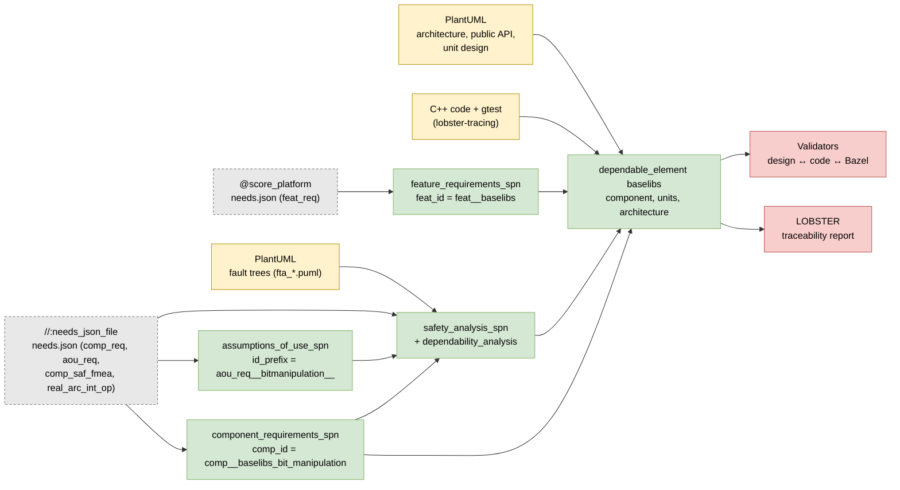

# Dependable element prototype: baselibs / bitmanipulation

Related pull requests (drafts, to be reviewed together):

| Repository | Pull request | Content |
|---|---|---|
| score_tooling | [#586](https://github.com/eclipse-score/tooling/pull/586) | rules_score: `*_spn` macros reading requirements from Sphinx-Needs |
| score_tooling | [#587](https://github.com/eclipse-score/tooling/pull/587) | rules_score: `safety_analysis_spn` (FMEA from Sphinx-Needs), on top of #586 |
| docs-as-code | [#1091](https://github.com/eclipse-score/docs-as-code/pull/1091) | `comp_saf_fmea` may violate `real_arc_int_op` |
| baselibs | [#863](https://github.com/eclipse-score/baselibs/pull/863) | dependable element with requirements from Sphinx-Needs |
| baselibs | this pull request | safety analysis from the Sphinx-Needs FMEA, on top of #863 |

Proof of concept for using the rules_score `dependable_element` of
[score_tooling](https://github.com/eclipse-score/tooling) with requirements and FMEA written
as Sphinx-Needs in score_docs_as_code, without TRLC. The return of test cases to the
documentation is out of scope.

## Data flow



* `feature_requirements_spn` / `component_requirements_spn` convert the `feat_req` /
  `comp_req` needs whose `satisfied_by` names `feat__baselibs` /
  `comp__baselibs_bit_manipulation` into LOBSTER items, like `lobster-trlc` does for TRLC.
* The gtest cases call `RecordProperty("lobster-tracing", "<comp_req id>")`.
* `safety_analysis_spn` turns the `comp_saf_fmea` needs violating
  `comp_arc_sta__baselibs__bit_manipulation` into failure modes and the `fta_*.puml` fault
  trees into root causes. A violated `real_arc_int_op` traces the failure mode to the
  method of `public_api.puml`; an FMEA rated `sufficient: yes` assesses the root causes of
  its tree with its `mitigated_by` measures.
* Checks: an unknown `fault_id` fails the build; a fault tree naming an unknown failure mode,
  an operation without public API method and an API method without failure mode are
  LOBSTER findings (`bazel test //dependable_element:bitmanipulation_dependability_analysis`).
* `maturity = "development"`: traceability gaps of the dependable element are reported as
  warnings (e.g. the root causes of the FMEA rated `sufficient: no`).

## Build

```bash
bazel build //dependable_element:baselibs_index
```

## Known gaps

* `feat_req` → `stkh_req` (`derived_from`) is not traced by the central conversion config.
* The interfaces are maintained twice: `real_arc_int(_op)` in `architecture/index.rst` and
  `public_api.puml`. Only the operations an FMEA names are checked against the diagram.
* `violates: real_arc_int_op` needs docs-as-code#1091, which goes beyond the process
  requirement `gd_req__saf_linkage_check`.
* Platform AoUs in `mitigated_by` are not measures of the analysis and are not traced.
