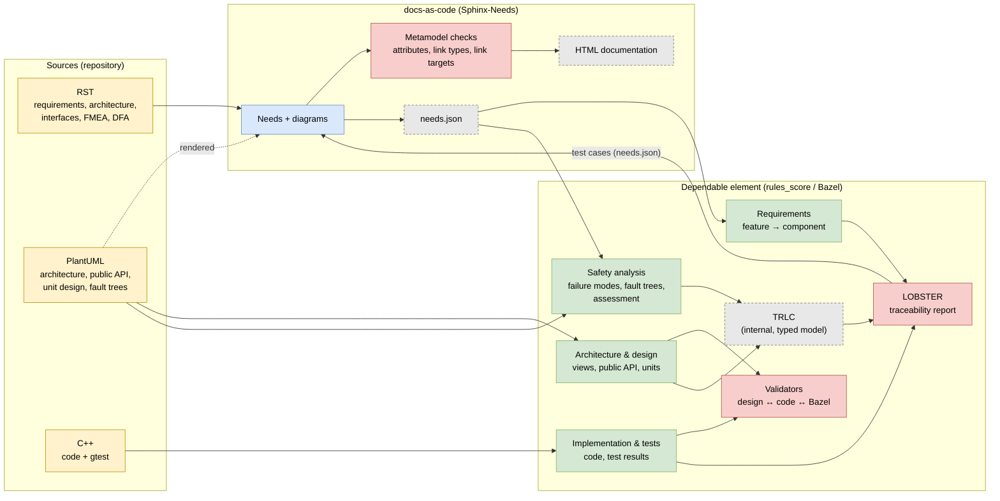
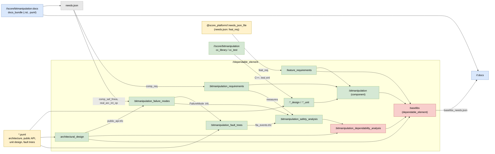
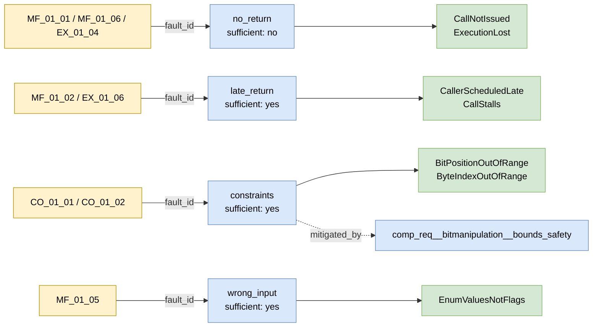

# Dependable element prototype: baselibs / bitmanipulation

Proof of concept for using the rules_score `dependable_element` of
[score_tooling](https://github.com/eclipse-score/tooling) with requirements, architecture
and the FMEA written as Sphinx-Needs in score_docs_as_code. Authors only maintain **RST**,
**PlantUML** and **C++**. Two checking instances work on these sources:

* **docs-as-code** (`//:docs`) checks every single need against the S-CORE metamodel and
  renders the documentation.
* **The dependable element** (`//dependable_element/...`, rules_score) checks that the
  traceability chain is complete and matches code, Bazel targets and test results.

## Overview

Yellow: maintained sources. Blue: docs-as-code. Green: dependable element. Grey dashed:
generated in the build only. Red: checking instances.

## Specification and check chain

| # | Artifact | Specified in | docs-as-code checks | Dependable element checks | CI effect |
|---|---|---|---|---|---|
| 1 | Feature requirements `feat_req` | score_platform (RST) | metamodel (in score_platform) | `feature_requirements(feat_id = "feat__baselibs")`: every `feat_req` is covered by a `comp_req` | soft |
| 2 | Component requirements `comp_req` | [requirements/index.rst](../score/bitmanipulation/docs/requirements/index.rst) | mandatory attributes, link types and targets (`derived_from`, `satisfied_by`) | filter `satisfied_by == comp__baselibs_bit_manipulation`; traced up to `feat_req`, down to tests | docs: hard, DE: soft |
| 3 | Architecture `comp`, `comp_arc_sta`, `comp_arc_dyn` | [architecture/index.rst](../score/bitmanipulation/docs/architecture/index.rst) + `bit_manipulation.puml`, `bitmask_operators.puml`, `dynamic.puml`, [docs/module/dependable_element.puml](../docs/module/dependable_element.puml) | link types (`belongs_to`, `fulfils`), rendering | static view ↔ Bazel targets, dynamic view ↔ public API, unit class diagram ↔ C++ (libclang) | hard |
| 4 | Interfaces `real_arc_int`, `real_arc_int_op` | [architecture/index.rst](../score/bitmanipulation/docs/architecture/index.rst) (title = method name) + `public_api.puml` | `included_by` → `real_arc_int`, `implements` → `logic_arc_int_op` | every `real_arc_int_op` matches exactly one method of `public_api.puml` | hard (build error) |
| 5 | Code | `//score/bitmanipulation` (C++) | – | against the unit design (step 3) | hard |
| 6 | Tests | `*_test.cpp` with `lobster-tracing` / `PartiallyVerifies` | imported test cases: their links to `comp_req` resolve | tests are executed (gtest); every `comp_req` has a test; export as `baselibs_needs.json` | docs: hard, DE: soft |
| 7 | Failure mode list | table in [fmea.rst](../score/bitmanipulation/docs/safety_analysis/fmea.rst) (no needs) | – | – | **not checked** |
| 8 | FMEA `comp_saf_fmea` | [fmea.rst](../score/bitmanipulation/docs/safety_analysis/fmea.rst) | mandatory fields (regex), `violates` → `comp_arc_sta`/`dyn`/`real_arc_int_op`, `mitigated_by` → `comp_req`/`aou_req`, targets exist | `fault_id` is a known fault model, `failure_effect` set, `violates` matches the public API, valid ASIL; `trlc --verify` | hard |
| 9 | Fault trees | `safety_analysis/fta_*.puml` (+ copy of `fta_metamodel.puml`) | rendering only (`.. uml::` in `fmea.rst`) | tree references an existing failure mode; every failure mode has root causes; every public API method has a failure mode; copy = original | hard |
| 10 | Assessment | no own file: derived from FMEA `sufficient` + `mitigated_by` | `sufficient` is yes/no | every root cause is assessed; measure version matches (`[version==N]`, `comp_req` only) | soft |
| 11 | DFA `comp_saf_dfa` | [dfa.rst](../score/bitmanipulation/docs/safety_analysis/dfa.rst) | metamodel | – | hard |

**Hard** fails CI. **Soft** is reported as a warning while the dependable element `baselibs`
has `maturity = "development"`.

Deliberate overlaps:

* **Link targets**: docs-as-code checks existence and type, the dependable element checks
  that the target matches the real code / API.
* **`fault_id`**: docs-as-code checks the format, the dependable element the content.
* **Test cases**: the dependable element runs and traces them, docs-as-code shows and links
  them.

## Data flow between the tools

1. **RST → `needs.json`**: the bundle `//score/bitmanipulation:docs` exports the needs of the
   component.
2. **`needs.json` → dependable element**: requirements, interfaces and the FMEA are read
   from it.
3. **PlantUML → TRLC**: `puml_cli` generates the `ApiMethod` records (public API) and the
   `RootCause` records (fault trees); `fmea_needs_to_trlc` generates the `FailureMode`
   records from the FMEA needs.
4. **TRLC / `needs.json` → LOBSTER**: one traceability report over the whole chain.
5. **Dependable element → docs-as-code**: the executed test cases come back as
   `baselibs_needs.json`, which `//:docs` imports and shows at the `comp_req`.

### Why TRLC is used internally

TRLC is the typed intermediate model of rules_score, generated in the build only
(`bazel-bin/dependable_element/*.trlc`) and never maintained:

* `RootCause.failure_modes` (fault trees) and `FailureMode.interface` (public API) are typed
  TRLC references. As `ApiMethod` and `RootCause` records are generated from PlantUML as
  TRLC, the failure modes between them must be TRLC records, too.
* `trlc --verify` checks these references and the enums (ASIL, guide words).
* `lobster-trlc` turns the records into LOBSTER items.

## Bazel targets

| Target | Rule | Input | Generates | Checks |
|---|---|---|---|---|
| `//score/bitmanipulation:docs` | `docs_bundle` | RST needs, PlantUML | `needs.json` | – (checked in `//:docs`) |
| `//:docs` | `docs` | bundles, `baselibs_needs.json` | HTML | metamodel of all needs incl. test cases |
| `:feature_requirements` | `feature_requirements` | platform `needs.json`, filter `feat_id` | `.lobster` | – |
| `:bitmanipulation_requirements` | `component_requirements` | bundle `needs.json`, filter `comp_id` | `.lobster` | – |
| `:*_design`, `:*_unit` | `unit_design`, `unit` | class diagram, `cc_library`, `cc_test` | `.lobster` from `test.xml` | class diagram ↔ C++ (libclang) |
| `:bitmanipulation` | `component` | units, requirements | `.lobster`, report | component ↔ Bazel |
| `:architectural_design` | `architectural_design` | static, dynamic, public API diagrams | `public_api.trlc` (`ApiMethod`) | views ↔ public API |
| `:bitmanipulation_failure_modes` | `failure_modes` | `needs.json` (`comp_saf_fmea`, `real_arc_int_op`), `public_api.trlc` | `*_needs.trlc` (`FailureMode`), `.lobster` | build: `fault_id`, API mapping, ASIL; `_test`: `trlc --verify` |
| `:bitmanipulation_fault_trees` | `fault_trees` | `fta_*.puml`, failure modes | `fta_events.trlc` (`RootCause`), `.lobster` | build: tree → existing failure mode |
| `:bitmanipulation_safety_analysis` | `safety_analysis` | failure modes, fault trees, measures (`comp_req`) | `assessments.lobster` (from `sufficient` / `mitigated_by`) | root cause ↔ failure mode |
| `:bitmanipulation_dependability_analysis` | `dependability_analysis` | safety analysis, architecture | LOBSTER report | **test, hard**: API method → failure mode → root cause |
| `:baselibs` | `dependable_element` | architecture, component, dependability, feature requirements | `baselibs_needs.json` (`testcase`), LOBSTER report | **test, soft**: whole chain incl. assessment and test coverage |
| `:fta_metamodel_copy_test` | `diff_test` | copy vs. `@score_tooling//plantuml:fta_metamodel` | – | **test, hard**: copy = original |

## Safety analysis: failure mode list, FMEA and fault trees

| Step | Question | Content | Form |
|---|---|---|---|
| **Failure mode list** | Which failure types are possible for this component at all? | fault models of the process (`gd_guidl__fault_models`: MF_01_xx, CO_01_xx, EX_01_xx) with applicability and rationale | table in `fmea.rst` |
| **FMEA** | What happens and how is it controlled? (inductive) | per applicable failure type (or group): `failure_effect`, `violates`, `mitigated_by`, `sufficient` | `comp_saf_fmea` needs |
| **Fault tree** | What can cause it? (deductive) | top event = FMEA failure mode, gates, leaves = root causes | `fta_*.puml` |
| **Assessment** | Is every root cause controlled? | a need with `sufficient: yes` assesses all root causes of its fault trees with its `mitigated_by` measures | derived by `safety_analysis` |

The 8 applicable fault models are bundled into 4 FMEA entries; every entry is the top event
of one fault tree. The root causes of "No Return" (`sufficient: no`) are reported as
unassessed.

The S-CORE process (`gd_req__saf_structure`) defines FMEA and DFA only; the fault trees are
an addition of rules_score that makes the free-text `failure_root_cause` structured and
checkable.

## CI

| CI job | Runs | Checks |
|---|---|---|
| `docs-build / Build Documentation` | `bazel run //:docs` | docs-as-code metamodel; warnings are errors |
| `Build and Test score-linux-x86_64` | `bazel build //...`, `bazel test //...` | dependable element: converters, validators, TRLC, LOBSTER |
| `Build and Test score-linux-aarch64` | `bazel test` without `//dependable_element/...` | the dependable element tests run on the host only, not under QEMU |

## Known gaps

1. **Failure mode list → FMEA**: nothing checks that every fault model marked applicable
   appears in a `fault_id`.
2. **Platform AoUs as measures** (`aou_req__platform__*`): docs-as-code only checks the link;
   the dependable element does not trace them.
3. **Soft checks**: with `maturity = "development"`, gaps in steps 1, 2, 6 and 10 do not
   fail CI.
4. **Guide word mapping**: `CO_01_01` / `CO_01_02` map to `TooEarly` / `TooLate`, following
   the comments of the `ScoreReq.Guideword` enum.
5. **Fault-tree macros**: `fta_metamodel.puml` is a copy for the documentation build,
   guarded by `:fta_metamodel_copy_test`.
