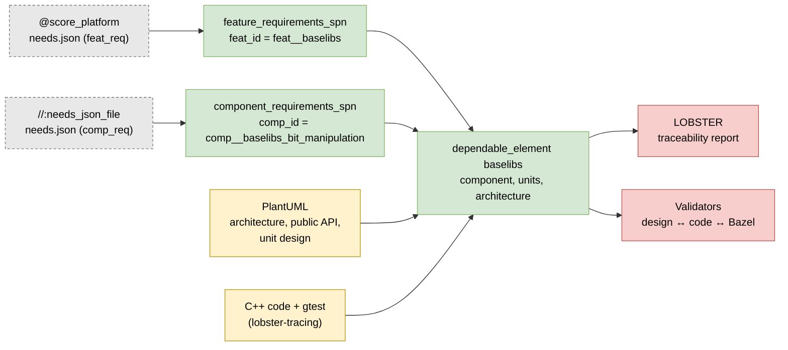

# Dependable element prototype: baselibs / bitmanipulation

Related pull requests (drafts, to be reviewed together):

| Repository | Pull request | Content |
|---|---|---|
| score_tooling | [#586](https://github.com/eclipse-score/tooling/pull/586) | rules_score: `*_spn` macros reading requirements from Sphinx-Needs |
| baselibs | this pull request | dependable element with requirements from Sphinx-Needs |

Proof of concept for using the rules_score `dependable_element` of
[score_tooling](https://github.com/eclipse-score/tooling) with requirements written as
Sphinx-Needs in score_docs_as_code. This prototype covers **requirements traceability
only**; the safety analysis (FMEA, fault trees) and the return of test cases to the
documentation are out of scope.

## Data flow



* `feature_requirements_spn` / `component_requirements_spn` convert the `feat_req` /
  `comp_req` needs whose `satisfied_by` names `feat__baselibs` /
  `comp__baselibs_bit_manipulation` into LOBSTER items, like `lobster-trlc` does for TRLC.
* The gtest cases call `RecordProperty("lobster-tracing", "<comp_req id>")`.
* `dependability_analysis = []` and `maturity = "development"`: traceability gaps are
  reported as warnings.

## Build

```bash
bazel build //dependable_element:baselibs_index
```

## Known gaps

* `feat_req` → `stkh_req` (`derived_from`) is not traced by the central conversion config.
* The interfaces are maintained twice: `real_arc_int(_op)` in `architecture/index.rst` and
  `public_api.puml`; nothing checks that they match.
