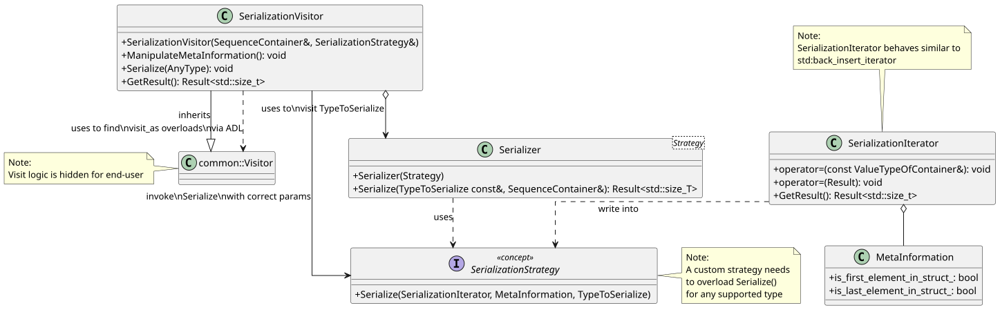

# Detailed Design

Within our code base we have various needs for serialization logic. Some of them being:

* data types to DLT (verbose and non-verbose)
* SOME/IP

In fact as of today we do all of these things different, even-though they are the same in their essence. The main point
is that the end format (the serialized format) always differs as also the requirements what types need to be serialized.
This library is an attempt to provide a common interface for the user for serialization as also a solid infrastructure
to ease the writing of serialization logic.

The main idea of the library is to split the responsibility between traversing types that should be serialized, the
storage handling (where data should be serialized to) and the serialization into a specific format.

For that reason we introduce so-called `SerializationStrategies` they should only care how data types are represented in
the serialized format. In order to do that, we provide a `SerializationIterator` which will take care of the storage
handling. Thus, the `SerializationStrategy` already does not care about which storage is used underneath. On the other
side the iterator does not care in which strategy he is invoked. The next building block is the visitor, we utilize here
the today already available `static_reflection_with_serialization/visitor`. In order to do so, we need a visitor (`SerializationVisitor`) that holds
all context information while traversing the provided type to serialize.

Last but not least, we have the common interface `Serializer` that can be customized by the API user with the needed
serialization strategy. He will then kick off the visitor and thus hide the traversing logic from the user.

